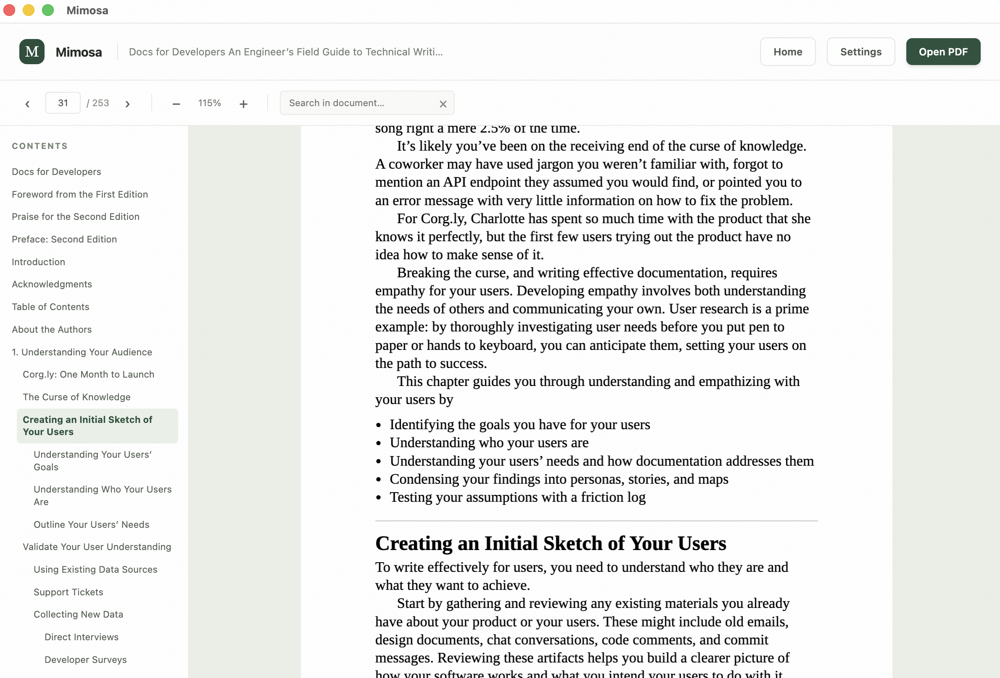

# Mimosa

**A focused macOS PDF reader for everyday work.**

Mimosa helps you read work documents, mark useful passages, translate selected text, and ask questions about a passage without losing your place. It is designed for technical specifications, research papers, reports, manuals, and other PDF-based materials.

> Early-stage macOS application.

## Screenshot



## Features

- **Read local PDFs:** Navigate pages, zoom, search the current page, select and copy text, and use a document outline when available.
- **Keep your notes with the document:** Underline passages, add comments, and revisit them later. Notes are stored locally and do not modify the source PDF.
- **Translate selected text:** Translate between English and Chinese using your configured OpenAI-compatible Chat Completions API.
- **Ask AI about a passage:** Ask questions about selected or underlined text. Answers support Markdown and are saved with the passage for later reference.
- **Resume reading:** Mimosa remembers the last page separately for each PDF.

## Privacy

Reading, notes, and page restoration work locally without an AI service. Translation sends only the selected text after confirmation. Ask AI sends the selected passage, text context from the same page, your question, and earlier messages in that conversation—not the entire PDF. API keys are stored using Electron `safeStorage` on macOS; conversation data and reading settings stay in Mimosa's local app data.

## Limitations

- Search, selection, underlining, and translation require extractable PDF text; built-in OCR is not available.
- Annotations are app-local and are not embedded in the PDF.
- Reading position restores the page, not the exact scroll offset.
- Translation and Ask AI require a compatible Chat Completions endpoint, a model, an API key, and network access. Provider-specific variants may not be compatible.
- Ask AI does not stream responses.
- macOS is the only supported desktop platform at this stage.

## Getting started

### Requirements

- macOS 12 or later.
- Node.js 22.12 or later and npm for development.

### Run from source

```sh
npm install
npm run dev
```

To configure translation and Ask AI, open Settings in the app and provide an OpenAI-compatible API endpoint, model, and API key. Reading and local notes do not require this configuration.

## Development

```sh
npm test -- --run  # Unit tests
npm run build       # Type-check and build the app
npm run test:e2e    # Electron end-to-end tests
```

The end-to-end suite launches application windows and can take focus on macOS. Run it only when desktop interaction is acceptable.

### Build a macOS package

```sh
npm run package:mac
```

The `.dmg` is written to `release/`. Packages are currently unsigned; macOS may show a security warning when opening them. Distribution requires a trusted Developer ID certificate and notarization.

## Project status

Mimosa is an early desktop application. The source PDF is never modified by annotations. There is no bundled AI service or API key, cloud synchronization, collaboration, OCR, or PDF editing beyond local underline annotations.
